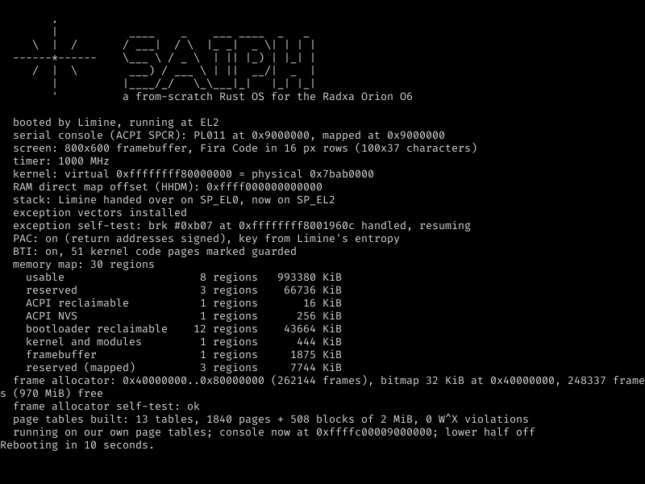
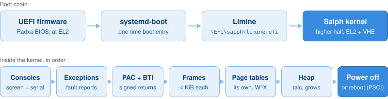
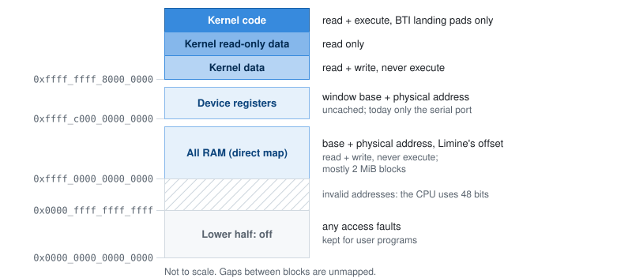

<div align="center">


# Saiph

**An operating system written from scratch in Rust, for the Radxa Orion O6.**

A learning and research OS for one Armv9 board, built in small steps. UEFI and Limine boot it, ACPI describes the hardware, and the CPU's own protections (pointer authentication, branch target identification and W^X page tables) are switched on as it boots. Saiph is the star at Orion's knee; Orion is the board.

[](LICENSE)


[](https://paypal.me/atayozc)



</div>

> [!NOTE]
> Saiph is at the very beginning. It boots, sets up its consoles, exception handling, memory protection and page tables, then powers off or restarts. There is no scheduler, no user space and no driver beyond the console yet. It runs in QEMU and on the real Orion O6.

## What works

- **Boots through UEFI and Limine** (boot protocol revision 6). It enters at EL2 with VHE, as on the board, or at EL1 under KVM.
- **A console on the screen and on serial.** The serial port comes from the ACPI SPCR table. On the screen, Saiph draws into the UEFI framebuffer in [Fira Code](https://github.com/tonsky/FiraCode), rendered into letter images at build time.
- **Readable crash reports**: the cause, the faulting address, the page-table level and every register.
- **Pointer authentication and BTI.** Return addresses are signed with a key from Limine's entropy, and kernel code only accepts branches to landing pads.
- **Physical memory**: a bitmap frame allocator over Limine's memory map.
- **Its own page tables**: each part of the kernel mapped W^X, all RAM in a direct map built mostly from 2 MiB blocks, a window for device registers, and the lower half switched off for future user programs.
- **Power off or reboot** through PSCI.
- **Deliberate faults on request** (`fault-test`, `pac-test`, `bti-test`, `wx-test`) that show each protection is enforced by the hardware, not just configured.

## Roadmap

- [x] Boot, consoles, exceptions, PAC and BTI
- [x] Frame allocator and its own page tables
- [x] First boot on the Orion O6
- [ ] Kernel heap
- [ ] Timer and interrupts (GIC-700)
- [ ] All 12 cores
- [ ] System calls, IPC and user programs (the kernel's design is decided here)
- [ ] Storage, USB and networking

The long-term plan, with research on every part of the board, is in [docs/roadmap.md](docs/roadmap.md). Every decision so far is in [docs/decisions.md](docs/decisions.md).

## The board

Saiph targets one machine: the [Radxa Orion O6](https://radxa.com/products/orion/o6/). Before the kernel was written, a small read-only UEFI program measured what the hardware actually does; its source is kept at the [`probe-final`](https://github.com/atayoez/saiph/tree/probe-final) tag. [FINDINGS.md](FINDINGS.md) has every answer with its evidence, plus what Saiph's own first boot showed.

| | |
|---|---|
| SoC | CIX P1 (CD8180): 8 × Cortex-A720 + 4 × Cortex-A520 |
| Firmware hands over at | EL2, with VHE |
| CPU protections | Pointer authentication (QARMA3, FPAC), BTI, MTE3 |
| Physical addresses | 40-bit, no LPA2 |
| Interrupt controller | Arm GIC-700 (GICv4.1) |
| IOMMU | Arm MMU-700 (SMMUv3.2), left off by the firmware |
| Serial console | PL011 at `0x040D0000` (ACPI SPCR) |
| Timer | 1 GHz |

## Try it

Saiph runs in QEMU on any machine, and under KVM on an arm64 Linux host. It needs the newest Rust nightly with `rust-src` and QEMU with the AAVMF firmware; the runner uses openSUSE's file location for the firmware. Limine comes bundled in [`limine/`](limine), so there is nothing to install for it. On openSUSE Tumbleweed:

```sh
sudo zypper install qemu-arm qemu-uefi-aarch64
rustup toolchain install nightly --component rust-src
```

Saiph follows the newest nightly and doesn't pin one: make it your default (`rustup default nightly`) or prefix commands with `+nightly`.

```sh
git clone https://github.com/atayoez/saiph.git
cd saiph
cargo kernel               # QEMU with an emulated CPU: enters at EL2, like the board
cargo kernel kvm           # KVM on an arm64 Linux host: enters at EL1
cargo kernel tcg wx-test   # crash on purpose (also fault-test, pac-test, bti-test)
```

The serial output appears in your terminal; quit early with Ctrl+A, then X. The virtual machine also has a screen; while it runs, `cargo screenshot` saves it as a PNG.

There are no scripts: `cargo kernel` is an alias for `cargo run -p kernel` with the flags the kernel needs. Cargo builds the kernel, then its runner hook hands the kernel file to [`runner/`](runner), a small Rust program that builds the boot disk image and starts QEMU.

The frame allocator, the page-table builder and the runner have unit tests that run on your computer:

```sh
cargo test
```

### On the Orion O6

If the board runs Linux with systemd-boot, Saiph can boot once without changing the normal boot:

```sh
cargo board
```

This copies Limine and the kernel to `\EFI\saiph` on the EFI system partition and arms a one-time boot entry, asking for your password once. Saiph shows its output on the screen, then reboots into Linux after 60 seconds. `cargo board remove` cleans up.

## How it works

<p align="center"></p>

The firmware starts systemd-boot, which starts Limine for one boot; Limine loads the kernel ELF into the upper half of the address space. The kernel brings up its consoles first, so that even an early failure is visible, then exception handling, pointer authentication and BTI, physical memory and finally its own page tables:

<p align="center"></p>

- **Branch protection everywhere.** Saiph is built for `aarch64-unknown-none-softfloat` with `-Zbuild-std` and `-Zbranch-protection=bti,pac-ret`, so `core` and every other crate it uses are compiled with signed return addresses and landing pads, not just the kernel's own code.
- **W^X by construction.** The [`paging`](paging) crate has no way to ask for a page that is both writable and executable, and the kernel checks every mapping after building its tables.
- **Single-user by design.** There will be no root and no user accounts. Programs will still be isolated from each other and from the kernel, just not by who is logged in.

## Project layout

| Path | What it is |
|---|---|
| [`kernel/`](kernel) | The kernel. `src/main.rs` is the boot sequence; `build.rs` renders the console font |
| [`frames/`](frames) | The bitmap frame allocator (`no_std`, host-tested) |
| [`paging/`](paging) | The page-table builder, with W^X built in (`no_std`, host-tested) |
| [`runner/`](runner) | Boots the kernel Cargo built: in QEMU, or once on the board |
| [`limine/`](limine) | The bundled Limine bootloader, its licences and Saiph's boot entry |
| [`docs/`](docs) | Decisions, the roadmap and research notes |
| [`FINDINGS.md`](FINDINGS.md), [`reports/`](reports) | What the hardware probe and Saiph measured on the board |

## Support

Saiph is free and always will be. If you enjoy following along, you can support its development:

[](https://paypal.me/atayozc)

Questions and ideas are welcome in [Issues](https://github.com/atayoez/saiph/issues).

## Credits

- [Limine](https://github.com/limine-bootloader/limine) boots Saiph; a copy of its official release is bundled in [`limine/`](limine). The [limine](https://crates.io/crates/limine) crate describes its boot protocol.
- The console font is [Fira Code](https://github.com/tonsky/FiraCode) by The Fira Code Project Authors, rendered at build time with [fontdue](https://github.com/mooman219/fontdue).
- The hardware probe was built on [uefi-rs](https://github.com/rust-osdev/uefi-rs).
- The roadmap draws on [seL4](https://sel4.systems), [Redox](https://www.redox-os.org), [Asterinas](https://asterinas.github.io), [Hubris](https://hubris.oxide.computer) and [Managarm](https://managarm.org), and the hardware knowledge on documentation, schematics and ACPI sources published by Radxa and CIX.

## License

Saiph is free software under the [GNU General Public License v3.0 or later](LICENSE). The Fira Code font in [`kernel/fonts/`](kernel/fonts) keeps its own license, the [SIL Open Font License 1.1](kernel/fonts/FiraCode-LICENSE.txt), and so does the bundled Limine in [`limine/`](limine) ([BSD-2-Clause](limine/LICENSE), plus [third-party notices](limine/3RDPARTY.md)).
